# 💬 Awesome Direct Messaging & Social Communication

> 🚀 **The definitive curated index of SaaS communication platforms, decentralized chat protocols, self-hosted team messengers, and open-source real-time messaging ecosystems.**

---

## 📌 Overview & Architecture Focus

Welcome to **Awesome Direct Messaging & Social Communication** — an exhaustive, SEO-optimized guide and architectural taxonomy of leading communication tools. This index catalogues:
- 🔐 **End-to-End Encrypted (E2EE) Messengers**: Signal Protocol, Double Ratchet, Autocrypt, and metadata-minimizing onion routing.
- 🌐 **Federated & Peer-to-Peer Protocols**: Matrix (Synapse/Conduit/Element), XMPP (Jabber), Nostr relays, and Briar Tor meshes.
- 🏢 **Self-Hosted Enterprise Collaboration**: Sovereign on-premise alternatives to Slack and Microsoft Teams (Mattermost, Rocket.Chat, Zulip).
- ⚡ **Real-Time Developer SDKs & Chat APIs**: CPaaS and hosted infrastructure powering in-app messaging, activity feeds, and voice/video streaming.

---

## 📑 Table of Contents

- [📊 Sector Overview & Market Dynamics](#-sector-overview--market-dynamics)
- [☁️ SaaS / Hosted Communication Platforms](#️-saas--hosted-communication-platforms)
- [🔓 Open-Source GitHub Projects (Ranked by Stars)](#-open-source-github-projects-ranked-by-stars)
- [🛠️ Architectural Design & Tech Stack Patterns](#️-architectural-design--tech-stack-patterns)
- [📈 Star History](#-star-history)
- [🤝 How to Contribute](#-how-to-contribute)
- [💖 Support & Sponsorship](#-support--sponsorship)
- [⚖️ Disclaimer](#️-disclaimer)

---

## 📊 Sector Overview & Market Dynamics

The global direct and mobile messaging sector is estimated at **$140B–$190B** (projected to exceed $250B+ by the late 2020s), driven by 6.8B+ smartphone users, conversational AI, and pervasive enterprise-to-consumer A2P/omnichannel routing. 

The market exhibits a **moderately concentrated, winner-take-most structure** at the consumer network and core CPaaS layer where massive network effects cement regional monopolies (Meta's WhatsApp, Tencent's WeChat, LINE, Telegram), but remains **fragmented across specialized niches** such as developer chat APIs, compliance-first workplace collaboration, and sovereign/decentralized communication infrastructures.

---

## ☁️ SaaS / Hosted Communication Platforms

The following SaaS and managed messaging providers are ranked in **descending order of valuation / company market capitalization**:

| 🏷️ Platform | 🏢 Valuation / Market Size | 💳 Pricing (Starting Paid Tier) | 🎁 Free Tier Limits / Trial Limits | 📝 Description |
| :--- | :--- | :--- | :--- | :--- |
| **[WhatsApp & WhatsApp Business](https://whatsapp.com)** (Meta) | ~$1.6 Trillion Market Cap (Meta Platforms, Inc.) | Paid per 24-hr conversation window after free allowance (e.g., ~$0.005–$0.08 per marketing/utility conversation depending on country) | **Free Forever**: Free mobile app for small businesses; WhatsApp Business Cloud API provides **1,000 free service (user-initiated) conversations per month** for every WhatsApp Business Account | Global cloud messaging and business communication platform offering end-to-end encrypted chats, verified business profiles, catalog messaging, and Cloud API webhooks. |
| **[Slack](https://slack.com)** (Salesforce) | ~$300 Billion Market Cap (Salesforce, Inc.) | **$8.75 per user/month** (Pro plan billed monthly, or $7.25/mo billed annually) | **Free Forever**: 90-day searchable message and file history, 1:1 audio/video Huddles, and up to 10 third-party app integrations | Cloud workplace direct messaging and channel collaboration platform featuring Huddles, Connect cross-organization DMs, workflow automation, and AI summaries. |
| **[Telegram Cloud Platform](https://telegram.org)** | ~$30 Billion Valuation (Est. private bond valuation; >$1B annual revenue) | **$4.99 per user/month** (Telegram Premium; ~$3.99/mo billed annually) | **Free Forever**: Unlimited messaging, groups up to 200,000 members, public broadcast channels, and up to 2 GB file upload size limit per file | High-speed cloud-synced messaging and broadcast ecosystem featuring massive group communities, mini-apps, bot APIs, and optional Secret Chats. |
| **[LINE](https://line.me)** (LY Corporation) | ~$23 Billion Market Cap (LY Corporation / SoftBank & Naver) | **¥5,000 per month** (~$33/mo for Light Business Account with 10,000 broadcast messages/mo) | **Free Forever**: Consumer app is 100% free; LINE Official Account (Business) free tier includes up to **200 free broadcast/targeted messages per month** | All-in-one social messaging and super-app ecosystem providing encrypted direct messaging, voice/video calls, official business accounts, and sticker/payment integrations. |
| **[Discord](https://discord.com)** | ~$9 Billion Valuation (Secondary private valuation; $15B Series H peak; ~$800M ARR) | **$2.99 per user/month** (Nitro Basic) or $9.99/mo (full Nitro) | **Free Forever**: Unlimited core voice, video, text chat, screen sharing (up to 720p/30fps), server creation up to 500,000 members, and up to 10 MB per attachment file upload limit | Real-time voice, video, and direct messaging platform built around persistent community servers, low-latency audio channels, and extensible bot/activity APIs. |
| **[Viber](https://viber.com)** (Rakuten Group) | ~$10 Billion Market Cap (Rakuten Group; acquired Viber for $900M) | **$5.99 per user/month** (Viber Plus) or pay-as-you-go VoIP credits via Viber Out | **Free Forever**: Unlimited encrypted 1:1 and group text messaging, voice/video calls to Viber contacts, and public community channels; business messaging includes free incoming chatbot messages | Cross-platform cloud messaging and VoIP calling platform featuring end-to-end encrypted personal and group chats, communities, and business messaging APIs. |
| **[Sendbird](https://sendbird.com)** | ~$1.05 Billion Valuation (Series C Unicorn; $220M+ total funding) | **$399 per month** (Starter plan billed monthly, covers up to 5,000 MAU) | **Free Forever**: Developer Plan free forever with a hard limit of **100 Monthly Active Users (MAU)** and 5 concurrent connections; 30-day Free Trial with Pro features capped at 1,000 MAUs | Cloud real-time messaging SDKs, conversational AI, and hosted chat APIs enabling developers to embed scalable direct messaging, voice calls, and moderation into mobile/web apps. |
| **[Stream Chat](https://getstream.io)** | ~$200 Million Valuation (Est. private valuation; $53M+ funding raised) | **$499 per month** (Standard Startup plan covers up to 10,000 MAU) | **Free Forever**: Free tier provides up to **1,000 MAU** and 100 peak concurrent connections; also offers an extended free Maker Account for qualified early-stage startups under $100k revenue | Enterprise-grade real-time messaging SDKs and hosted chat infrastructure enabling high-performance direct messaging, activity feeds, and automated moderation pipelines. |
| **[Element Matrix Services (EMS)](https://element.io)** | ~$150 Million Valuation (Est. private valuation; $48M+ funding raised) | **$5.00 per user/month** (Element Cloud Starter, or $10/user/month for Element Business) | **Free Forever**: Free account on public `matrix.org` federated cloud (attachments capped ~10–100 MB); self-hosted Element Community Edition is free forever for up to **100 seats/users** | Managed cloud hosting for Matrix homeservers and Element clients providing sovereign, federated, end-to-end encrypted messaging for enterprises and public-sector teams. |
| **[Threema](https://threema.ch)** | ~$30 Million Valuation (Est. private buyout by Comitis Capital / Afinum; ~$5M ARR) | **CHF 3.00 (~$3.40) per user/month** (Threema Work Core, billed annually) or $5.99 one-time consumer app purchase | **Free Trial**: **30-day Free Trial** for Threema Work with full feature access for up to **30 users** (no credit card required, terminates automatically without renewal) | Privacy-focused end-to-end encrypted messenger hosted in Switzerland requiring no phone number or email address (featuring open-source clients paired with secure infrastructure). |

---

## 🔓 Open-Source GitHub Projects (Ranked by Stars)

Each repository below features a live GitHub stargazer badge linking directly to the repository's stargazers page, sorted in **descending order by Stars_Count**:

1. **[Rocket.Chat (`RocketChat/Rocket.Chat`)](https://github.com/RocketChat/Rocket.Chat)**  
     
   🚀 Interoperable by design and governed by community sovereignty. Enterprise-grade open-source communication platform, Matrix federation support, and complete Slack/Teams replacement.

2. **[Mattermost (`mattermost/mattermost`)](https://github.com/mattermost/mattermost)**  
     
   💼 High-security, open-source platform for mission-critical developer collaboration, integrated playbooks, board workflows, and enterprise direct/channel messaging.

3. **[Telegram Desktop (`telegramdesktop/tdesktop`)](https://github.com/telegramdesktop/tdesktop)**  
     
   ⚡ Official open-source C++ and Qt-based desktop client for Telegram, supporting high-throughput cloud messaging, large communities, and MTProto encryption.

4. **[Signal Android (`signalapp/Signal-Android`)](https://github.com/signalapp/Signal-Android)**  
     
   🛡️ The gold standard for open-source private messaging. Built on the Signal Protocol (Double Ratchet, Sesame, X3DH) offering zero-knowledge end-to-end encrypted chats and VoIP.

5. **[Zulip (`zulip/zulip`)](https://github.com/zulip/zulip)**  
     
   🧵 Powerful open-source group and direct messaging platform uniquely combining real-time chat with email-like topic threading for productive, asynchronous team communication.

6. **[SimpleX Chat (`simplex-chat/simplex-chat`)](https://github.com/simplex-chat/simplex-chat)**  
     
   🔒 The first messaging network operating with **zero user identifiers** (no phone numbers, usernames, or persistent public keys), transmitting double-ratchet encrypted payloads via unidirectional queues.

7. **[Element Web / Desktop (`element-hq/element-web`)](https://github.com/element-hq/element-web)**  
     
   🌐 Glossy, full-featured web and desktop client for Matrix, providing decentralized, end-to-end encrypted messaging, voice/video conferencing, and cross-platform bridge management.

8. **[Tinode (`tinode/chat`)](https://github.com/tinode/chat)**  
     
   ⚡ Pure open-source instant messaging server written in Go, featuring gRPC/REST/WebSockets with native clients for iOS (Swift), Android (Java), and web (React/JavaScript).

9. **[Nostr Protocol (`nostr-protocol/nostr`)](https://github.com/nostr-protocol/nostr)**  
     
   📡 Truly censorship-resistant, decentralized social and direct messaging network protocol relying on simple cryptographic keypairs and federated relays.

10. **[ejabberd (`processone/ejabberd`)](https://github.com/processone/ejabberd)**  
      
    🏰 Robust, fault-tolerant enterprise messaging server written in Erlang/Elixir, supporting XMPP and MQTT protocols for handling millions of concurrent users.

11. **[Matrix Synapse (`element-hq/synapse`)](https://github.com/element-hq/synapse)**  
      
    🏛️ Reference open-source Matrix homeserver implementation written in Python and Rust, powering the backbone of decentralized secure communication across global organizations.

12. **[Revolt / Stoat Backend (`revoltchat/backend`)](https://github.com/revoltchat/backend)**  
      
    🎮 User-first, open-source chat and community platform engineered in Rust, built as a privacy-respecting self-hostable alternative to Discord.

13. **[Matrix Rust SDK (`matrix-org/matrix-rust-sdk`)](https://github.com/matrix-org/matrix-rust-sdk)**  
      
    🦀 High-performance client-server SDK for Matrix written in Rust, powering next-generation mobile applications (Element X) with native sliding sync and cryptographic speed.

14. **[Mautrix WhatsApp Bridge (`mautrix/whatsapp`)](https://github.com/mautrix/whatsapp)**  
      
    🌉 Matrix-to-WhatsApp puppeting bridge written in Go, allowing users to send and receive WhatsApp direct messages within their unified Matrix chat interface.

15. **[Delta Chat Android (`deltachat/deltachat-android`)](https://github.com/deltachat/deltachat-android)**  
      
    📧 Decentralized private messenger that uses standard email infrastructure (IMAP/SMTP) paired with Autocrypt E2EE, requiring no specialized chat servers.

16. **[Delta Chat Desktop (`deltachat/deltachat-desktop`)](https://github.com/deltachat/deltachat-desktop)**  
      
    💻 Multi-platform desktop client (Windows, macOS, Linux) for Delta Chat, turning any standard email account into an encrypted instant messenger.

17. **[Briar (`briar/briar`)](https://github.com/briar/briar)**  
      
    📡 Resilient, peer-to-peer encrypted messenger built for journalists and activists; routes messages directly over Tor, Bluetooth, or local Wi-Fi without central servers or internet access.

18. **[Session Desktop (`session-foundation/session-desktop`)](https://github.com/session-foundation/session-desktop)**  
      
    🧅 Private desktop messenger operating over a decentralized, onion-routed node network (Oxen Service Nodes), leaving zero digital footprints and requiring no phone numbers.

19. **[Gajim XMPP Client (`gajim/gajim`)](https://github.com/gajim/gajim)**  
      
    🪶 Feature-rich XMPP client written in Python and GTK, supporting OMEMO end-to-end encryption, multi-device synchronization, and secure group chats.

20. **[oh-my-dm (`guhyunwoo/oh-my-dm`)](https://github.com/guhyunwoo/oh-my-dm)**  
      
    🕶️ Modern, discreet agent CLI-based direct messaging tool engineered for clean conversational workflows directly within terminal environments.

21. **[Jami Client (`savoirfairelinux/jami-client-qt`)](https://github.com/savoirfairelinux/jami-client-qt)**  
      
    📞 Official GNU package offering serverless, peer-to-peer encrypted audio/video calling, screen sharing, and direct messaging built on OpenDHT.

---

## 🛠️ Architectural Design & Tech Stack Patterns

When architecting a real-time messaging or social communication platform, consider these tested patterns:

- 🧱 **High-Privacy Sovereign Stack**: Combine **SimpleX Chat** or **Briar** for zero-metadata exposure, or self-host a **Matrix Synapse / Conduit** homeserver paired with **Element X** and **Mautrix Bridges** to federate across proprietary silos (WhatsApp, Slack, Signal).
- 🏢 **Enterprise Workplace Stack**: Deploy **Mattermost** or **Rocket.Chat** on Kubernetes with PostgreSQL and Redis to retain total data custody and meet GDPR/HIPAA compliance.
- ⚡ **Developer Embedded Chat**: Integrate **Stream Chat** or **Sendbird** for high-volume consumer mobile apps requiring out-of-the-box offline sync, reactions, unread counters, and typing indicators.

---

## 📈 Star History

---

## 🤝 How to Contribute

Contributions are warmly welcomed! Help keep this ecosystem comprehensive, accurate, and up to date:

1. 🍴 **Fork the repository** on GitHub.
2. 🌿 **Create a feature branch** (`git checkout -b feature/add-new-messenger`).
3. ✏️ **Add your entry** following existing tabular/badge guidelines (ensure valid pricing tiers or live GitHub stargazer badges).
4. 🧪 **Check link validity** and ensure descriptions are objective and technical.
5. 🚀 **Submit a Pull Request** with a brief summary of the project added.

---

## 💖 Support & Sponsorship

Thank you so much for exploring and supporting open-source software and privacy-first communication! If you find this directory valuable:

- ⭐ **Star this repository** to improve visibility across GitHub.
- 🍴 **Fork & Share** with your engineering team, security peers, or privacy community.
- ☕ **Buy me a coffee / Sponsor**: If this curation saved you research time, consider sponsoring via the [GitHub Sponsor Dashboard](https://github.com/sponsors/ishandutta2007). Sponsorship tiers include profile badges, README acknowledgments, and priority review on pull requests!

---

## ⚖️ Disclaimer

- This curated list is maintained for educational and architectural research purposes. Mention of proprietary products does not imply commercial endorsement.
- Proprietary networks (Telegram, WhatsApp) maintain central control over infrastructure even when clients are open-sourced. For guaranteed sovereign encryption across clients and servers, utilize open protocols like Matrix, SimpleX Chat, or XMPP.
- Always verify public cryptographic safety numbers and fingerprints out-of-band when communicating high-sensitivity information.
